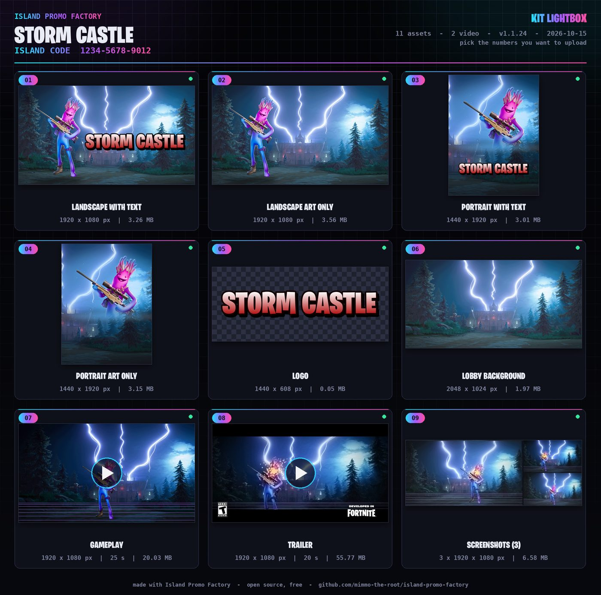
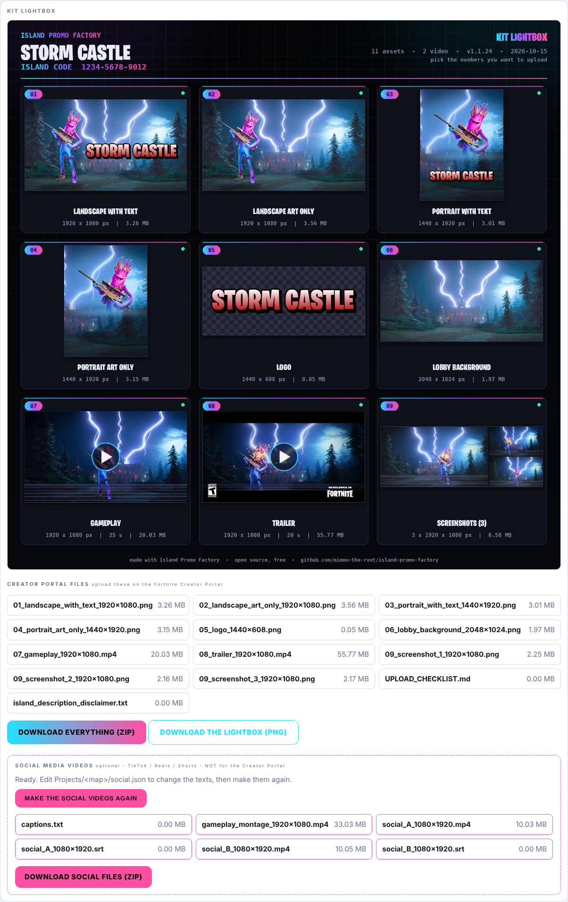

# Island Promo Factory

**Your whole Fortnite island promo kit in one run: thumbnails, logo, lobby image, gameplay video, trailer and screenshots, already in Epic's sizes and checked against Epic's current rules.**

Free, open source (MIT), and it runs on your own PC. You never upload your art anywhere.

[**Read the manual**](https://mimmo-the-root.github.io/island-promo-factory/) · [See the demo results](https://mimmo-the-root.github.io/island-promo-factory/demo/) · [Latest release](https://github.com/mimmo-the-root/island-promo-factory/releases/latest) · [What's new](https://mimmo-the-root.github.io/island-promo-factory/whatsnew.html)


<sup>Everything above came out of one run on a demo map built in UEFN. Fortnite and Unreal Editor for Fortnite are trademarks of Epic Games, Inc.; Island Promo Factory is an unofficial tool.</sup>

## Why creators use it

- **Hours of editing become one run.** Give it a screenshot of your island, a character render and a gameplay recording. Come back to numbered files named like the Creator Portal fields.
- **Epic's rules are built in.** Sizes, safe areas, file limits, video length and colour tagging come from Epic's own pages (checked 15 Oct 2026, mandatory from 22 Oct 2026). Every file is validated and the run tells you exactly what to fix.
- **Real gameplay stays real.** The portal gameplay video is one continuous, unedited cut of your recording, with its original audio. The trailer uses your real clips, your island code and the rating badge.
- **Crisp text, always.** The AI draws the art only; titles and logo are rendered with a real font, so nothing is misspelled or smeared.
- **Faster the second time.** Every stage is cached: change a title or a clip and only what depends on it runs again.
- **A live console.** A page on your PC shows progress, the results as they appear, A/B variants of the artwork and every download in one click.
- **Social videos, if you want them.** An optional extra makes vertical 9:16 videos with English subtitles for TikTok, Reels and Shorts, kept apart from the portal files so you never upload the wrong one.

## What you get

| File | Spec |
|---|---|
| Landscape thumbnail (with title / art only) | 1920x1080, under 5 MB |
| Portrait thumbnail (with title / art only) | 1440x1920, under 5 MB |
| Island logo | 1440x608, transparent PNG |
| Lobby background | 2048x1024 |
| Gameplay video | 1920x1080, 15-30 s, one unedited cut of your recording (MP4 + ProRes MOV) |
| Trailer | 1920x1080, 15-30 s, your clips, end card, age-rating and "Developed in Fortnite" badges |
| Screenshots (3) | 1920x1080 |
| Kit Lightbox + upload checklist | one board with every file, and a checklist for the portal |
| Social videos (optional) | 1080x1920, 15-30 s, English subtitles and captions |

> Specs reflect the Creator Portal in October 2026. Epic changes them: always check the portal. Details: [docs/SPECS.md](docs/SPECS.md).



## Try it in minutes

```bat
doctor.bat        :: tells you what is ready and the exact fix for what is not
demo.bat          :: a complete demo kit, no GPU needed (about 15 minutes, once)
```

Then your own island:

```bat
new_map.bat my-map "MY MAP TITLE" --style SCI_FI
:: put your files in Projects\my-map\
::   background\background.png        the environment, no characters, at least 1920 px wide
::   characters\character_01.png      ONE character, transparent PNG with margin on all sides
::   captures\gameplay\recording.mp4  a 5+ minute recording of your island (recommended)
:: edit Projects\my-map\config.json   (island code, title, style)
run_all.bat my-map                    :: add --social for the vertical videos, --no-qwen without ComfyUI
dashboard.bat my-map                  :: reopen the live console
```

Results are in `Projects\my-map\promo_pack\`. Full walkthrough: **[the manual](https://mimmo-the-root.github.io/island-promo-factory/)**.

## Works with Claude Code

Open the folder in Claude Code and type `/promo-pack`. Claude asks for the island code, title and files, starts everything, runs every step, checks the results and writes a report. After the kit it offers the optional social videos. You never have to double-click a `.bat` file. At every session start the kit syncs its skills and tells you when a newer release exists (`/promo-update`).

## Choose your setup

| Setup | You need | You get |
|---|---|---|
| **Full** | Windows, NVIDIA GPU with about 12 GB VRAM, ~55 GB disk, ComfyUI + models (`download_models.bat`) | everything, including AI horizontal art, AI music and A/B variants |
| **Light** | Windows, any PC, Python, ffmpeg | everything except AI art and AI music: you supply the horizontal art, the music comes from the built-in synthesiser |
| **Remote ComfyUI** | Light + a ComfyUI on another PC or in the cloud (`COMFY_URL`) | the Full result on a weak PC |

ComfyUI and the models (about 45 GB) are not included; `download_models.bat` fetches them. Step by step: [docs/INSTALL.md](docs/INSTALL.md).

## Your brand, your files (not included)

- **Font:** drop a `.otf`/`.ttf` in `Resources/brand/font/`. Without one an open-licensed fallback is used. Fortnite's Burbank is not distributed here.
- **Badges:** put the official rating badge and "Developed in Fortnite" files in `Resources/badges/`. Get them from their owners.
- **Music:** optional `Projects/<map>/audio/music.mp3` (use only music you are licensed to use); otherwise the kit generates an original track.
- **Gameplay and screenshots** come from *your* recording.

## Good to know

- Nothing is uploaded and nothing is deleted: old results move to `_previous` folders. You upload the files yourself and you are responsible for following Epic's rules.
- Qwen does not obey numeric positions, so the vertical art is composed by script, not by the model.
- The trailer is edited footage of your own recording; it is not AI video.
- Unofficial tool, not affiliated with, endorsed or sponsored by Epic Games. See [DISCLAIMER.md](DISCLAIMER.md), [NOTICE.md](NOTICE.md) and [SECURITY.md](.github/SECURITY.md).

## Documentation

[Manual](https://mimmo-the-root.github.io/island-promo-factory/) · [Install](docs/INSTALL.md) · [Usage and settings](docs/USAGE.md) · [Updating](docs/UPDATING.md) · [Specs](docs/SPECS.md) · [Changelog](CHANGELOG.md)

`python tests/smoke_test.py` builds a synthetic map end to end with a mock ComfyUI server: no GPU, no game assets.

## Made by

[@mimmo_the_root](https://x.com/mimmo_the_root) on X. MIT for the code (see [LICENSE](LICENSE)); models, fonts, badges and game content have their own licences.
